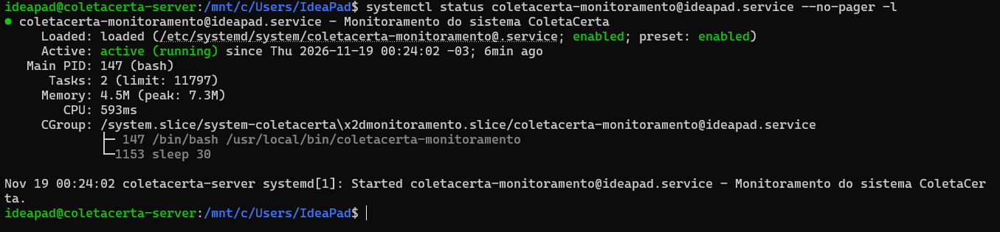
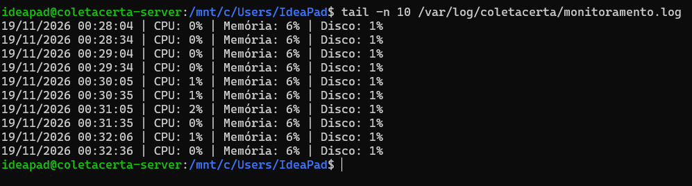

# ColetaCerta --- Infraestrutura Linux

## Sobre o projeto

Infraestrutura Linux desenvolvida para o Global Solution 2026.2 ---
CitizenTech, da FIAP.

O ambiente prepara e hospeda a versão Web do aplicativo ColetaCerta,
desenvolvido com React Native e Expo.

A infraestrutura automatiza a configuração de rede, instalação de
dependências, geração do build Web, publicação com Nginx e monitoramento
dos recursos do sistema.

## Tecnologias utilizadas

-   Ubuntu 24.04 LTS
-   WSL 2
-   Bash
-   Node.js 22
-   npm
-   Expo
-   Nginx
-   systemd
-   Git

## Aplicação hospedada

A versão Web do aplicativo é gerada pelo Expo e publicada pelo Nginx.

**Diretório de publicação:** `/var/www/coletacerta`

**Endereço de acesso:** `http://localhost`

**Repositório da aplicação:**\
https://github.com/werbethnunes/coletacerta-mobile

## Estrutura do repositório

``` text
coletacerta-infraestrutura/
├── config/
│   └── coletacerta
├── evidencias/
│   ├── auditoria-monitoramento.log
│   └── prints/
├── logs/
├── scripts/
│   ├── diagnostico-rede.sh
│   ├── monitoramento.sh
│   ├── provisionamento-rede.sh
│   └── provisionamento.sh
├── services/
│   └── coletacerta-monitoramento@.service
└── README.md
```

## Requisitos

-   Ubuntu 24.04 LTS com WSL 2.
-   Acesso à internet.
-   Usuário com permissões sudo.
-   Git instalado.
-   systemd habilitado no WSL.

## Preparação do ambiente

Clone o repositório de infraestrutura:

``` bash
git clone https://github.com/werbethnunes/coletacerta-infraestrutura.git
cd coletacerta-infraestrutura
```

## Provisionamento da rede

Execute:

``` bash
sudo bash scripts/provisionamento-rede.sh
```

O script configura o hostname `coletacerta-server` e verifica:

-   Interface de rede.
-   Endereço IPv4.
-   Gateway padrão.
-   Servidor DNS.
-   Resolução de nomes.
-   Conectividade externa.

No WSL 2, os parâmetros de rede são gerenciados pelo próprio ambiente e
podem mudar.

Após a configuração, reinicie o WSL pelo PowerShell:

``` powershell
wsl --shutdown
```

## Provisionamento da aplicação

Execute:

``` bash
sudo bash scripts/provisionamento.sh
```

O script realiza:

1.  Atualização dos pacotes.
2.  Instalação de Nginx, Git, cURL e htop.
3.  Configuração do repositório Node.js 22, quando necessário.
4.  Verificação do Node.js e npm.
5.  Clonagem do repositório Mobile, caso ainda não exista.
6.  Instalação das dependências com `npm ci`.
7.  Geração do build Web com `npx expo export --platform web`.
8.  Publicação dos arquivos em `/var/www/coletacerta`.
9.  Configuração e validação do Nginx.
10. Inicialização automática do Nginx.
11. Verificação da aplicação por requisição HTTP.
12. Instalação do script de monitoramento.
13. Configuração do serviço systemd.
14. Habilitação e inicialização automática do monitoramento.

Para verificar:

``` bash
sudo systemctl status nginx
curl -I http://localhost
```

Uma resposta HTTP 200 indica que o servidor está entregando a aplicação.

## Monitoramento dos recursos

O script `scripts/monitoramento.sh` monitora:

-   CPU.
-   Memória RAM.
-   Uso de disco.

A coleta ocorre a cada 30 segundos.

O limite de alerta está configurado em 80%.

Os registros são armazenados em:

`/var/log/coletacerta/monitoramento.log`

Para consultar:

``` bash
tail -f /var/log/coletacerta/monitoramento.log
```

## Serviço systemd

O serviço `coletacerta-monitoramento@.service` executa o monitoramento
em segundo plano.

A instalação e inicialização do serviço são realizadas automaticamente
pelo script `provisionamento.sh`.

Durante o provisionamento, são realizadas as seguintes etapas:

1.  Instalação do script de monitoramento em `/usr/local/bin/`.
2.  Criação do diretório de logs com as permissões adequadas.
3.  Instalação do serviço systemd.
4.  Atualização das configurações do systemd.
5.  Habilitação e inicialização automática do serviço.

A configuração utiliza `Restart=always` e `RestartSec=5`, permitindo a
recuperação automática do processo quando encerrado.

**Consultar o serviço:**

``` bash
systemctl status "coletacerta-monitoramento@$(id -un).service"
```

**Consultar os registros:**

``` bash
journalctl -u "coletacerta-monitoramento@$(id -un).service"
```

## Diagnóstico de rede

Execute:

``` bash
bash scripts/diagnostico-rede.sh
```

O script verifica hostname, interface, IP, gateway, DNS, resolução de
nomes e conectividade externa.

## Logs e auditoria

Os registros de provisionamento e diagnóstico ficam no diretório
`logs/`.

O monitoramento registra os indicadores em
`/var/log/coletacerta/monitoramento.log`.

O systemd mantém o histórico de inicialização, falhas e recuperação,
consultável pelo `journalctl`.

## Testes realizados

-   Validação de sintaxe dos scripts Bash.
-   Configuração de hostname e rede.
-   Teste de resolução DNS e conectividade externa.
-   Reinicialização do WSL.
-   Instalação das dependências.
-   Geração do build Web do Expo.
-   Publicação da aplicação no Nginx.
-   Verificação da resposta HTTP.
-   Coleta de CPU, memória e disco.
-   Simulação de condições de alerta.
-   Teste de recuperação automática pelo systemd.
-   Verificação da inicialização automática após reinicialização do WSL.

## Evidências

As capturas dos procedimentos e testes estão disponíveis em
`evidencias/prints/`.

### 01. Diagnóstico de rede


### 02. Provisionamento Mobile


### 03. Aplicação Mobile Web


### 04. Monitoramento ativo



### 05. Recursos monitorados



### 06. Alertas de monitoramento


### 07. Recuperação automática


### 08. Nginx ativo


### 09. Configuração do Nginx


## Integrantes

  Nome               RM
  ------------------ --------
  Werbeth Nunes      559067
  Rodrigo Leme       550266
  Thamiris Almeida   559155
  Dayana Ticona      558023
  Larissa Biusse     564068

## Instituição

FIAP --- Engenharia de Software
