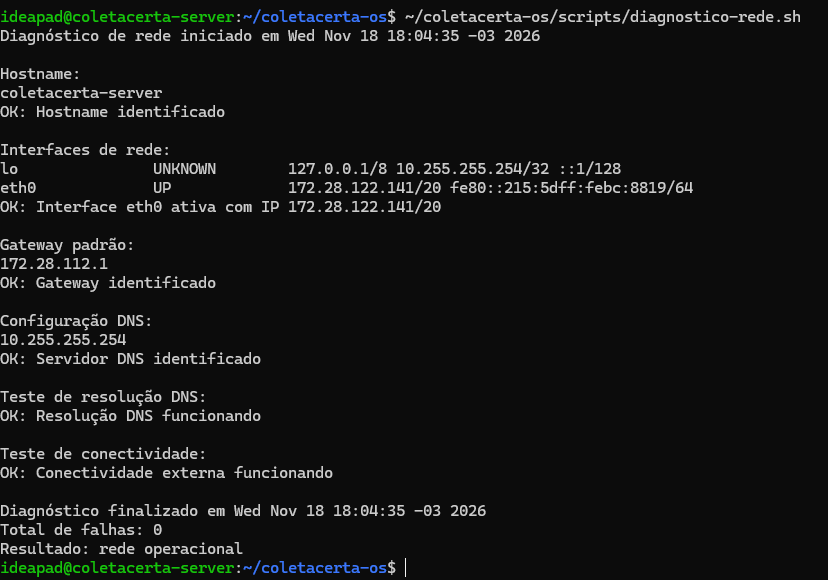
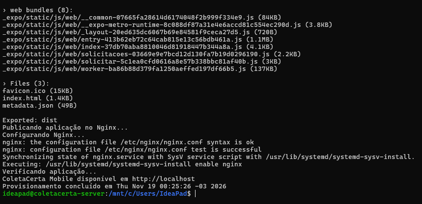
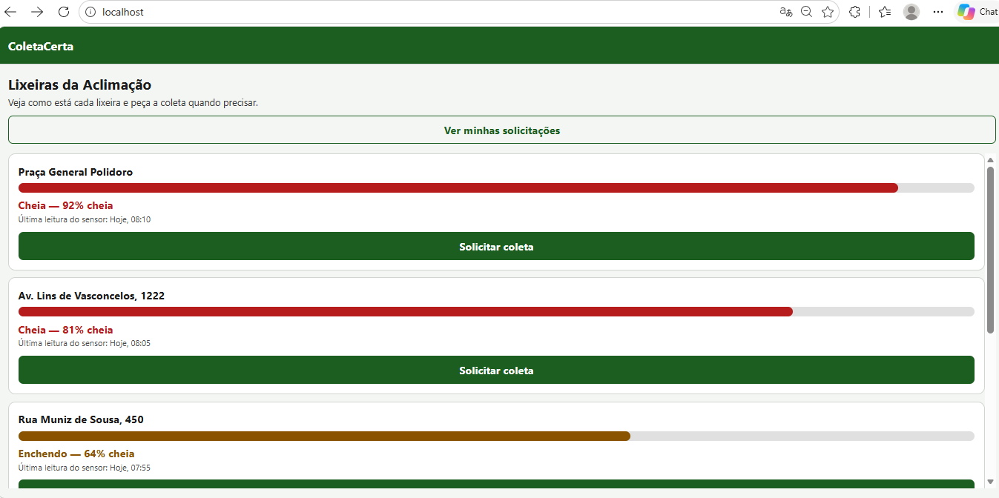
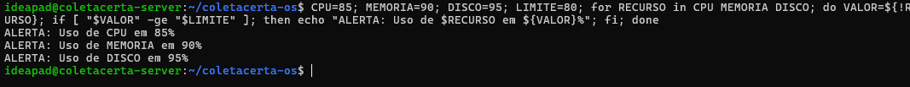
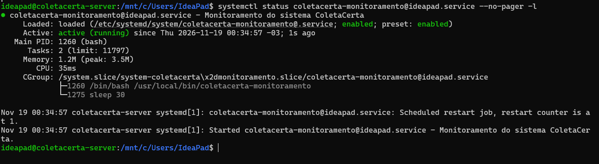
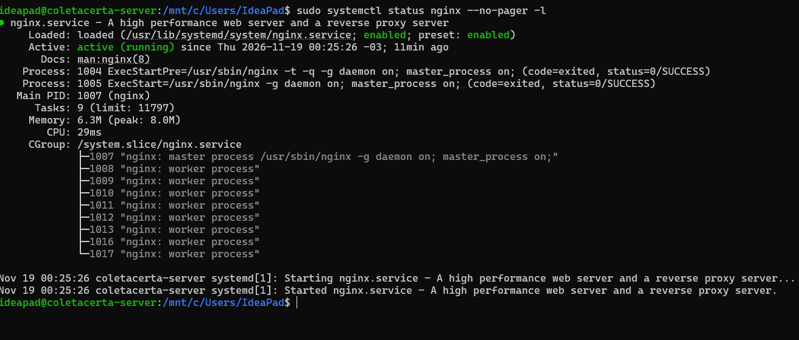
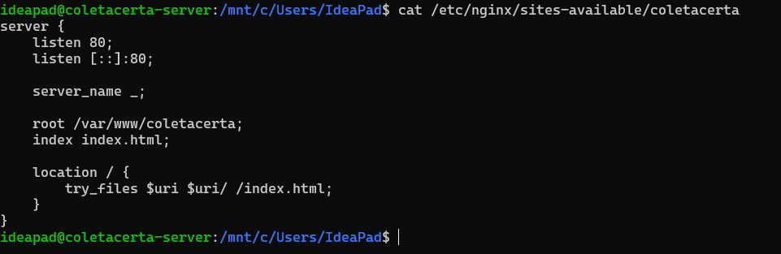

# ColetaCerta - Infraestrutura Linux

## Sobre o projeto

Este projeto apresenta a configuração de um ambiente Linux para hospedar a aplicação ColetaCerta. Foram desenvolvidos scripts Bash para configurar a rede, instalar os componentes necessários, publicar a aplicação e monitorar os recursos do sistema.

O trabalho faz parte do Global Solution 2026.2 - CitizenTech, da FIAP, e utiliza recursos do Linux para automatizar tarefas e gerenciar serviços.

## Tecnologias utilizadas

- Ubuntu
- WSL 2
- Bash
- Node.js 22
- npm
- Expo
- Nginx
- systemd
- Git

## Aplicação hospedada

A versão Web da aplicação é gerada pelo Expo e disponibilizada pelo servidor Nginx.

- **Diretório:** `/var/www/coletacerta`
- **Endereço:** `http://localhost`
- **Repositório Mobile:** https://github.com/werbethnunes/coletacerta-mobile

## Estrutura do repositório

```text
coletacerta-infraestrutura/
├── config/
│   └── coletacerta
├── evidencias/
│   ├── auditoria-monitoramento.log
│   └── prints/
├── logs/
├── scripts/
│   ├── diagnostico-rede.sh
│   ├── monitoramento.sh
│   ├── provisionamento-rede.sh
│   └── provisionamento.sh
├── services/
│   └── coletacerta-monitoramento@.service
└── README.md
```

## Requisitos

- Ubuntu com WSL 2.
- Acesso à internet.
- Usuário com permissões sudo.
- Git instalado.
- systemd habilitado no WSL.

## Preparação do ambiente

Clone o repositório e entre na pasta do projeto:

```bash
git clone https://github.com/werbethnunes/coletacerta-infraestrutura.git
cd coletacerta-infraestrutura
```

## Configuração de rede

Execute o script:

```bash
sudo bash scripts/provisionamento-rede.sh
```

Esse script configura o WSL para utilizar o systemd, define o hostname como `coletacerta-server` e verifica as informações da rede:

- Interface de rede;
- Endereço IP;
- Gateway padrão;
- Servidor DNS;
- Resolução de nomes;
- Conectividade externa.

O IP, o gateway e o DNS são identificados a partir das configurações atuais do WSL 2, que gerencia esses parâmetros dinamicamente.

Após executar o script, reinicie o WSL pelo PowerShell:

```powershell
wsl --shutdown
```

## Instalação e publicação da aplicação

Execute:

```bash
sudo bash scripts/provisionamento.sh
```

O script automatiza as seguintes etapas:

1. Atualização dos pacotes do sistema.
2. Instalação do Nginx, Git, cURL e htop.
3. Instalação do Node.js 22, caso necessário.
4. Verificação das versões do Node.js e npm.
5. Clonagem do repositório Mobile, caso ainda não exista.
6. Instalação das dependências com `npm ci`.
7. Geração da versão Web com Expo.
8. Cópia dos arquivos gerados para `/var/www/coletacerta`.
9. Configuração e validação do Nginx.
10. Inicialização do servidor.
11. Teste de acesso à aplicação.
12. Instalação do script de monitoramento.
13. Configuração do serviço systemd.
14. Inicialização automática do monitoramento.

Para verificar o funcionamento do Nginx:

```bash
sudo systemctl status nginx
```

Para testar a resposta da aplicação:

```bash
curl -I http://localhost
```

## Monitoramento do sistema

O script `monitoramento.sh` acompanha o uso de três recursos:

- CPU;
- Memória RAM;
- Disco.

As verificações são realizadas a cada 30 segundos. Quando o uso de algum desses recursos atinge 80%, o script registra um alerta no arquivo de monitoramento.

Os registros ficam em:

```text
/var/log/coletacerta/monitoramento.log
```

Para acompanhar os registros em tempo real:

```bash
tail -f /var/log/coletacerta/monitoramento.log
```

## Serviço systemd

O monitoramento é executado em segundo plano por meio do serviço `coletacerta-monitoramento@.service`.

O serviço é instalado e iniciado pelo script de provisionamento. Sua configuração utiliza:

- `Restart=always`: reinicia o processo quando ele é encerrado.
- `RestartSec=5`: aguarda cinco segundos antes de tentar reiniciar.

Para consultar o status:

```bash
systemctl status "coletacerta-monitoramento@$(id -un).service"
```

Para consultar o histórico:

```bash
journalctl -u "coletacerta-monitoramento@$(id -un).service"
```

## Diagnóstico de rede

Para executar o diagnóstico:

```bash
bash scripts/diagnostico-rede.sh
```

O script verifica o hostname, as interfaces de rede, o IP, o gateway, o DNS, a resolução de nomes e a conectividade externa.

O resultado também é salvo em:

```text
logs/diagnostico-rede.log
```

## Logs e auditoria

Os registros das execuções ficam organizados nos seguintes arquivos:

| Arquivo | Conteúdo |
|---|---|
| `logs/provisionamento.log` | Registro da instalação e configuração da aplicação |
| `logs/diagnostico-rede.log` | Resultado dos testes de rede |
| `logs/monitoramento.log` | Histórico de CPU, memória, disco e alertas |
| `evidencias/auditoria-monitoramento.log` | Registros utilizados como evidência de auditoria |

O histórico do serviço também pode ser consultado pelo `journalctl`.

## Testes realizados

Durante os testes, foram verificadas as seguintes etapas:

- Sintaxe dos scripts Bash.
- Configuração do hostname.
- Identificação de IP, gateway e DNS.
- Resolução de nomes e conectividade externa.
- Reinicialização do WSL.
- Instalação das dependências.
- Geração do build Web.
- Publicação da aplicação pelo Nginx.
- Acesso à aplicação por HTTP.
- Coleta de CPU, memória e disco.
- Simulação de condições de alerta.
- Recuperação automática do serviço após interrupção.
- Inicialização do serviço após reinicialização do ambiente.

## Evidências

As imagens abaixo mostram os procedimentos realizados e os resultados dos testes. Os arquivos originais estão na pasta `evidencias/prints/`.

### 01. Diagnóstico de rede



### 02. Provisionamento da aplicação



### 03. Aplicação hospedada



### 04. Serviço de monitoramento ativo


### 05. Monitoramento de recursos


### 06. Simulação de alertas



### 07. Recuperação automática



### 08. Nginx em execução



### 09. Configuração do Nginx



## Integrantes

- **Werbeth Nunes** — RM: 559067
- **Rodrigo Leme** — RM: 550266
- **Thamiris Almeida** — RM: 559155
- **Dayana Ticona** — RM: 558023
- **Larissa Biusse** — RM: 564068

## Instituição

FIAP — Engenharia de Software
